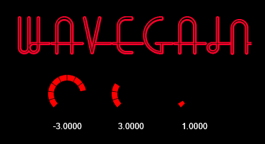

# Wavegain



Wavegain is a simple audio plugin written in C++ and built with Steinberg VST 3 SDK, that supports three parameters:

| Name | Range | Default | Unit | Description |
|---|---|---|---|---|
| Volume | -60 to +12 | -3 | dB | Base gain applied to the signal |
| LFO Amplitude | 0 to 10 | 3 | dB | Depth of the sine wave modulation: the gain swings symmetrically this many dB above and below base Volume |
| LFO Frequency | 0.5 to 10 | 1 | Hz | Frequency of the sine wave that modulates the gain |

When the LFO Amplitude equals 0, the plugin works as a plain gain control. Otherwise, it applies a wobbling effect to the volume.

## Requirements

### To build

- **CMake 3.25 or newer.**
- **A C++17 compiler.** Development is done on Windows with Visual Studio 2026 (MSVC, x64).
- **Steinberg VST 3 SDK**, including VSTGUI. Developed against SDK version 3.8.1. The SDK is not part of this repository; if you clone it from GitHub, use `--recursive` so the `vstgui4` submodule is included:

  ```
  git clone --recursive https://github.com/steinbergmedia/vst3sdk.git
  ```

- **The SDK location**, given in one of two ways:
  - the `VST3_SDK_ROOT` environment variable, or
  - `-DVST3_SDK_ROOT=<path>` on the CMake command line.

  Configuration stops with an error if the path is empty or does not contain the SDK's `CMakeLists.txt`.

### Windows notes

- With the SDK's default settings, the build creates a symbolic link to the plug-in in `C:\Program Files\Common Files\VST3`. This needs either Developer Mode enabled or an elevated (administrator) build. To skip it, configure with `-DSMTG_CREATE_PLUGIN_LINK=OFF`.
- The SDK's validator runs automatically after each build (`SMTG_RUN_VST_VALIDATOR`), so a build fails if the plug-in does not pass validation.

### macOS

- The CMake file sets a deployment target of macOS 10.13 and a bundle identifier, so an Xcode build is configured, but it is not regularly tested.

### To run

- A VST 3 host (DAW) on a 64-bit system.
- The whole `Wavegain.vst3` bundle folder must be installed, not just the binary inside it — the editor's resources (`editor.uidesc`, `logo.png`) live in the bundle.

### Optional

- **Steinberg VST3PluginTestHost**, used as the debug executable for the Visual Studio and Xcode targets.
